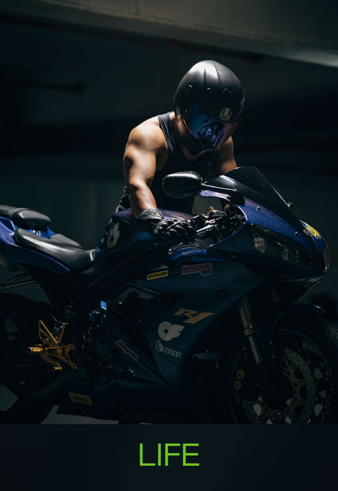
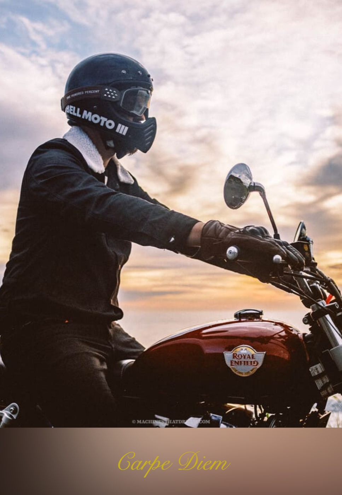

# 模糊画框 / Frame & Mat

**English** · [中文](README.zh-CN.md)

Turn a good photograph into a framed poster worth sharing.

Import a photo and the app adds a white mat, a shadow, a background treatment, and a camera spec plate, then exports a social-ready PNG. Everything runs locally in the browser; photographs never leave the device.

## Samples

| | |
| --- | --- |
|  |  |

## Features

### Styles

- Nine built-in styles: Classic (经典), Polaroid (拍立得), Magazine Cover (杂志封面), Cinematic (电影感), Postcard (明信片), Minimal (留白), Social Square (社媒方形), Story (竖版故事), and Spec Sheet (样张).
- Five canvas ratios — 4:5, 16:9, 3:2, 1:1, and 9:16. Every style chip is a real render of the current photo, so the mat, backdrop, and canvas shape are visible before you choose.
- Save the current adjustments as a template (存为模板), stored locally and available later as a custom style.

### Photos

- Import several photos at once, or by drag-and-drop and paste.
- Switch or delete from the photo list; deleting also removes the locally stored original.
- The working session is saved automatically; photos, current style, text, and adjustments return after a refresh or an unexpected close.

### Text and camera plate

- Only the slots the current style prints are shown: Classic has title and subtitle, Polaroid and Spec Sheet each have one title slot, and Minimal shows no text panel.
- Typed text follows the user across styles.
- Each slot has its own font and size; the block has an anchor (top / mat / center / bottom) and a percentage nudge.
- Fonts include machine presets — 楷体 (Kaiti), 宋体 (Songti), 行楷 (Xingkai), 手写体 (handwriting), 圆体 (rounded), 隶书 (Lishu), plus several Latin script faces — and your own `.ttf` / `.otf` / `.woff` / `.woff2` files.
- Spec Sheet reads the photo's EXIF and prints a camera plate: camera and exposure on two lines, one line when the data is incomplete, and nothing when there is no metadata.

### Mount adjustments

- Foreground size, horizontal/vertical position, corner radius, mat/bottom mat, and backdrop zoom, blur, and darkening.
- Slider ceilings are derived from the layout geometry, so dragging to the maximum never crops the image.
- In No Background mode only the three card-related controls remain: radius, mat, and bottom mat.
- Reset to the style's authored values, undo, and redo. History covers mount adjustments and text; the photo list is deliberately excluded.

### Background and border

- **With Background** (带背景): the photo's own blurred copy fills the backdrop; output uses the template canvas.
- **No Background** (无背景): only the mount itself is written — a smaller file with a cleaner edge.
- In No Background, the border material can be **White** (白边) or **Blur** (模糊, the photo's own blur extending past the frame).

### Export and experience

- PNG export. Save requests 2× by default (about 2304×2880 for a 4:5 canvas) and steps down automatically when the canvas limit is exceeded.
- Three-column desktop layout and a single-screen mobile layout; the light/dark theme follows the system and can be toggled manually. The mat stays white in both themes.
- Pure frontend: no account, no backend, no uploads.

## Development

Requires Node.js 20+.

```bash
npm install
npx playwright install chromium   # required the first time for browser tests
npm run dev
```

Stack: TypeScript + Vite, plain DOM and Canvas 2D, no frontend framework.

### Common commands

| Command | Purpose |
| --- | --- |
| `npm run dev` | Start the dev server |
| `npm run build` | Type-check and produce a static build in `dist/` |
| `npm run test` | Node unit tests for pure functions and layout rules |
| `npm run test:pixel` | Playwright browser tests: layout relationships, canvas invariants, pixel goldens |

Full gate:

```bash
npm run build && npm run test && npm run test:pixel
```

`test:pixel` builds the app and serves `dist/` on `:4173` itself, so free the port before running it.

Pixel goldens live in `tests/pixel/__screenshots__/` — one per built-in template, rendered in the light theme (the mat is white in both themes, so the same golden also asserts dark mode). Update them only after confirming an intended visual change, and commit the new goldens with the code change:

```bash
npx playwright test tests/pixel/templates.spec.ts --update-snapshots
```

## Project structure

- `src/core/` — framework-free pure logic: rendering, geometry, templates, EXIF, text, and size ceilings. **Must not import from `src/ui/`**, which keeps the core math testable directly in Node.
- `src/ui/` — panels, state, history, persistence, and export. Each panel is a pure model plus a thin DOM layer.
- `src/main.ts` — app wiring and event binding; `index.html` is the shell.
- `tests/unit/` — pure functions and rules; `tests/pixel/` — real-browser layout, pixel invariants, and goldens.

## Data and privacy

Data lives only in the browser:

- `localStorage`: theme, custom templates, and the session record (photo list, active photo, mount, text).
- `IndexedDB`: original photo bytes and uploaded fonts.

Persistence is capped at 24 photos or 256 MB, oldest evicted first. When storage is refused, the quota is exceeded, or a record is corrupt, the app degrades rather than breaking; a session that cannot be restored starts fresh. There is no backend and no upload.

## Deploy

`npm run build` produces a static site; serve `dist/` from any static host. It must be served over HTTP — ES modules do not load from `file://`. The repo ships a GitHub Pages workflow that builds and deploys on pushes to `main`; for a project site under a subpath, set Vite's `base` via `PAGES_BASE`.

## Dev affordances

| Query | Effect |
| --- | --- |
| `?dev=1` | Exposes debug handles such as `window.__frame` for tests and console inspection |
| `?demo=1` | Loads a procedurally generated sample photo without reading or writing the real session; a reload is always the same photo |
| `?demo=1&tpl=<id>` | The sample photo with a named template; `tpl` is read only alongside `demo=1` |

## Known limitations and unbuilt work

- **Save as template does not store the words.** A template record holds layout, typography, and geometry; title and subtitle belong to the current session.
- **The in-memory photo list has no cap.** Persistence is limited to 24 photos / 256 MB, but every loaded photo is decoded and kept in memory; importing a large batch of high-resolution photos can exhaust browser memory.
- **4× export is unverified on real iOS Safari.** The fallback ladder is covered in CI, but WebKit's actual over-budget behavior is simulated; the Save button only requests 2×, and 4× is reachable only through the dev handle.
- **The mount panel only adjusts the frame.** Crop, straighten, tone looks, and collage layouts are not implemented; no panel value changes a pixel of the photo itself.
- **Payments are a seam only.** The `premium` flag and entitlements interface exist, but v1 allows everything and nothing is gated.
- **`?selftest=1` and `?pixcheck=1` are not implemented.** The export-pixel reads of the latter are covered by `tests/pixel/`.
- **Legacy `?demo=1` may have left photos behind.** Earlier builds persisted the demo photo into the session; those photos keep appearing in the list and must be removed one by one.
