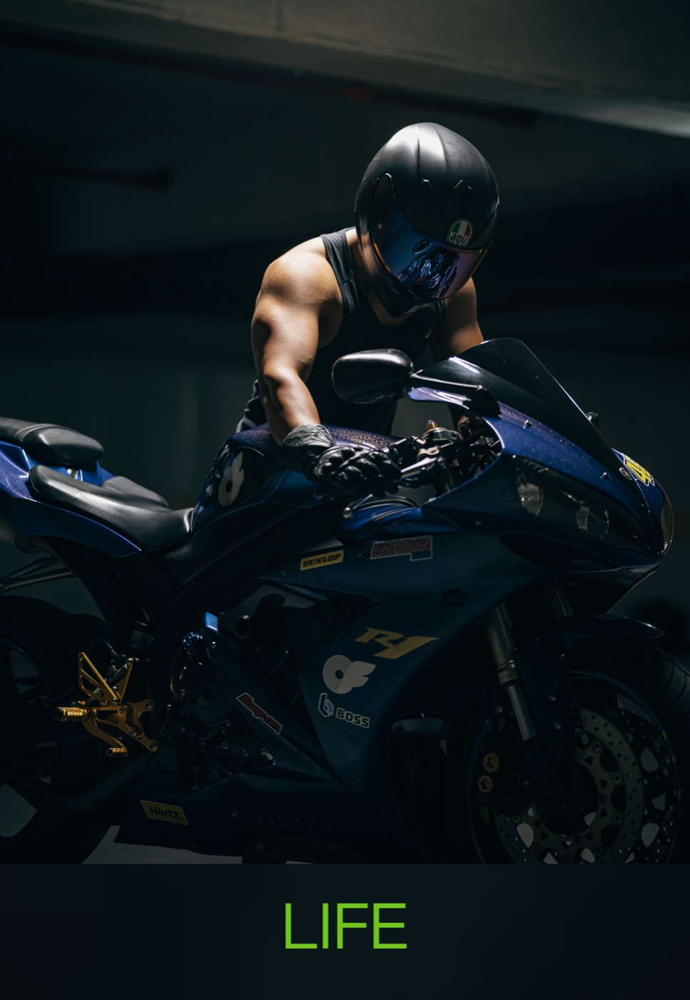
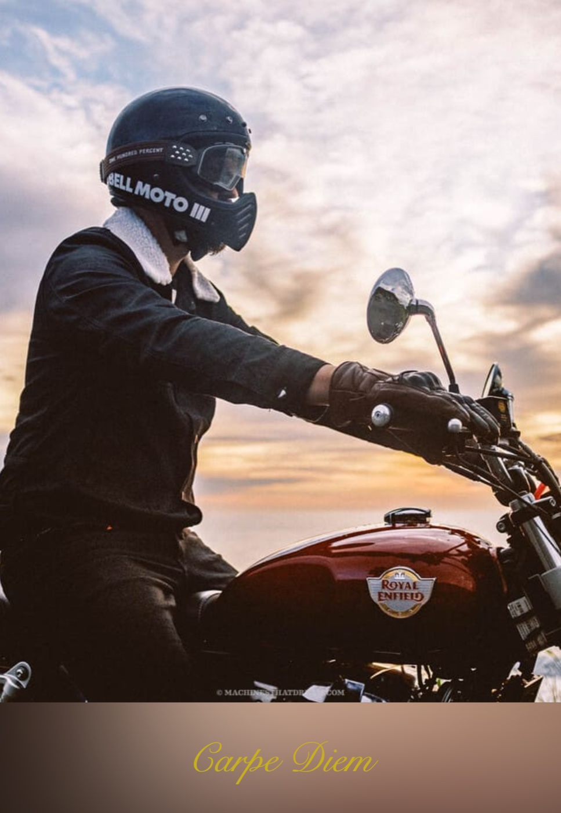

# 模糊画框 / Frame & Mat

[English](README.md) · **中文**

把一张好照片，变成值得发出去的画框海报。

导入照片，应用会为它加上白边卡纸、阴影、背景处理和相机参数牌，并导出适合社交分享的 PNG。全部处理在浏览器本地完成，照片不会离开设备。

## 样张

| | |
| --- | --- |
|  |  |

## 功能

### 样式

- 9 款内置样式：经典、拍立得、杂志封面、电影感、明信片、留白、社媒方形、竖版故事、样张。
- 覆盖 4:5、16:9、3:2、1:1、9:16 五种画幅，选中前即可看到真实渲染的小图预览。
- 当前调整可「存为模板」，保存在本地，之后作为自定义样式再次选用。

### 照片

- 支持多选导入、拖拽和粘贴。
- 左侧照片列表可随时切换、删除；删除会同时移除本地原图。
- 工作现场自动保存，刷新或意外关闭后恢复照片、当前样式、文字与参数。

### 文字与相机参数

- 只显示当前样式会绘制的槽位：经典有标题和副标题，拍立得、样张各有一个标题位，留白不显示文字面板。
- 标题、副标题等文字内容跟随用户，切换样式不丢失。
- 每个槽位可选字体、字号；文字块可选锚点（顶部 / 白边 / 居中 / 底部）并整体微调位置。
- 字体支持系统预设（楷体、宋体、行楷、手写体、圆体、隶书及多款西文手写体），也可上传 `.ttf` / `.otf` / `.woff` / `.woff2` 文件。
- 样张样式会自动读取照片 EXIF 生成相机参数牌：有相机和曝光时排两行，信息不全时降级为一行，没有参数则不显示。

### 画面调节

- 可调前景大小、水平/垂直位置、圆角、白边/下白边，以及后景放大、后景虚化、后景压暗。
- 滑杆上限由版式几何推导，拖到最大也不会裁掉画面。
- 无背景时只保留影响卡纸的三项：圆角、白边、下白边。
- 支持重置为样式原始值，以及撤销/重做；撤销历史覆盖相框参数与文字，照片列表不在其中。

### 背景与白边

- **带背景**：用照片自身的虚化版本铺底，按模板画布输出。
- **无背景**：只输出卡纸本身，文件更小，边缘更干净。
- 无背景时边框材质可选「白边」（纯白卡纸）或「模糊」（照片自身模糊后延伸过边框）。

### 导出与体验

- 导出 PNG，保存时默认请求 2×（4:5 画幅约 2304×2880），超出画布限制时自动降级。
- 桌面三栏布局，手机单屏布局；明暗主题跟随系统并可手动切换，卡纸在两种主题下都保持白色。
- 纯前端、无账号、无后端，照片不上传。

## 开发

要求 Node.js 20+。

```bash
npm install
npx playwright install chromium   # 首次运行浏览器测试需要
npm run dev
```

技术栈：TypeScript + Vite，原生 DOM 与 Canvas 2D，无前端框架。

### 常用命令

| 命令 | 作用 |
| --- | --- |
| `npm run dev` | 启动开发服务器 |
| `npm run build` | 类型检查并生成静态产物到 `dist/` |
| `npm run test` | Node 单元测试，覆盖纯函数与版式规则 |
| `npm run test:pixel` | Playwright 浏览器测试：布局关系、Canvas 不变量、像素基线 |

完整校验：

```bash
npm run build && npm run test && npm run test:pixel
```

`test:pixel` 会自行构建并占用 `:4173` 端口，运行前需确保端口空闲。

像素基线位于 `tests/pixel/__screenshots__/`，每个内置样式一张，以浅色主题渲染为准（卡纸在两个主题下都是白色，因此同一张基线同时校验明暗主题）。确认视觉改动符合预期后更新基线，并与代码改动一起提交：

```bash
npx playwright test tests/pixel/templates.spec.ts --update-snapshots
```

## 项目结构

- `src/core/` — 无框架依赖的纯逻辑：渲染、几何、模板、EXIF、文字与尺寸上限。**不允许引用 `src/ui/`**，核心数学因此可在 Node 中直接测试。
- `src/ui/` — 面板、状态、历史、持久化与导出。每个面板是「纯模型 + 薄 DOM」的拆分。
- `src/main.ts` — 应用装配与事件绑定；`index.html` 是页面骨架。
- `tests/unit/` — 纯函数与规则；`tests/pixel/` — 真实浏览器中的布局、像素不变量与基线。

## 数据与隐私

数据只存放在浏览器本地：

- `localStorage`：主题、自定义模板、会话记录（照片列表、当前照片、相框参数、文字）。
- `IndexedDB`：照片原文件与用户上传的字体。

持久化上限为 24 张照片或 256 MB，超出后按最旧优先淘汰。存储被拒绝、配额不足或记录损坏时，应用尽量降级而不是中断；无法恢复的会话会以全新状态启动。没有后端，也没有任何上传。

## 部署

`npm run build` 产出纯静态文件，将 `dist/` 部署到任意静态托管即可。必须通过 HTTP 访问，ES 模块无法从 `file://` 加载。仓库自带 GitHub Pages workflow，推送到 `main` 自动构建部署；部署在子路径时通过 `PAGES_BASE` 指定 Vite 的 `base`。

## 开发辅助

| 查询参数 | 作用 |
| --- | --- |
| `?dev=1` | 暴露 `window.__frame` 等调试句柄，供测试和控制台检查 |
| `?demo=1` | 载入一张程序生成的示例照片，不读写真实会话，刷新始终是同一张 |
| `?demo=1&tpl=<id>` | 示例照片 + 指定模板；`tpl` 仅在 `demo=1` 时生效 |

## 已知限制与未实现

- **存为模板不保存文字内容。** 模板记录只包含版式、字体与几何参数；标题、副标题属于当前会话。
- **照片列表在内存中没有上限。** 持久化限制是 24 张 / 256 MB，但已载入的照片都会解码驻留内存；一次导入大量高像素照片可能耗尽浏览器内存。
- **4× 导出尚未在真实 iOS Safari 验证。** 降级阶梯已在 CI 中覆盖，但 WebKit 的真实超限行为仍是模拟；当前保存按钮只请求 2×，4× 仅通过开发接口可达。
- **画面面板只调整相框。** 裁剪、校正、调色与拼贴布局尚未实现，任何参数都不会修改照片本身的像素。
- **付费仅为接口预留。** `premium` 标记与权益接口已存在，但 v1 全部放行，没有实际拦截。
- **`?selftest=1` 与 `?pixcheck=1` 未实现。** 后者读取导出像素的能力已由 `tests/pixel/` 覆盖。
- **旧版 `?demo=1` 可能留下示例照片。** 历史版本会把示例照片写入会话；这些照片会继续出现在列表中，需要手动逐张删除。
